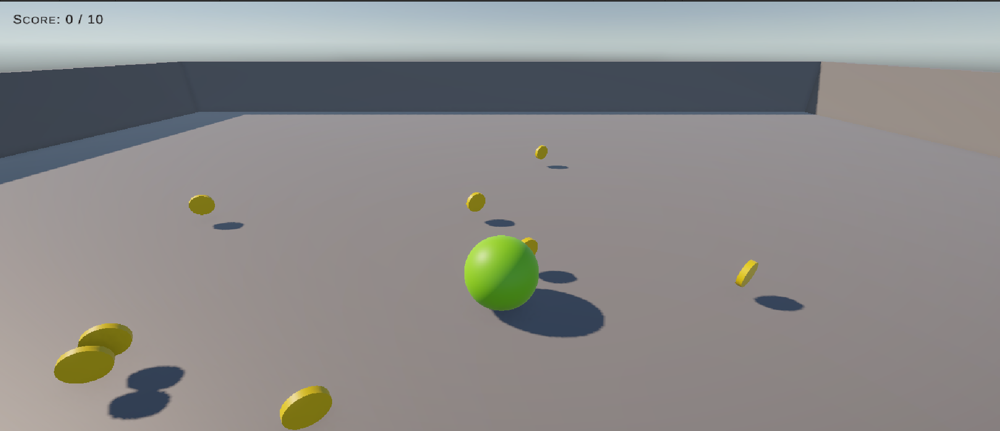

# Lab 05

**Name:** Mustafa Fawwaz | **Roll Number:** BSSE23036

This repository contains the custom implementation and extension of the classic Unity Roll-a-Ball tutorial, featuring a finite normal coin economy, a randomized mid-round Red Coin event, and a procedural 360-degree circular bonus coin burst mechanic.

## Technical Architecture & Scripts

- **`GameManager.cs`**: Central controller managing the 10-coin limit, random Red Coin threshold selection, Game Over state, UI updates, and the mathematical $360^\circ$ circular instantiation of the 50 Blue Coins.
- **`PlayerController.cs`**: Handles physics-based forces and camera-relative player movement.
- **`CameraFollow.cs`**: Implements smooth follow and mouse-orbit camera behavior.
- **`Coin.cs`, `RedCoin.cs`, `BlueCoin.cs`**: Individual trigger and rotation components that communicate with the `GameManager` via `FindAnyObjectByType`.

## Gameplay Showcase & Deliverables

**Gameplay Recording (Google Drive Link):** https://drive.google.com/file/d/1F81SbGsWjMKYT1gL0F0jrbgwlJBEngMD/view?usp=sharing

### Screenshots

